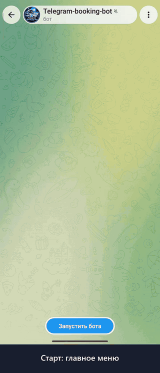

# Telegram Booking Bot

<p align="center"></p>

🇷🇺 [Русская версия](README.md) · The demo GIF shows the Russian UI; set `BOT_LANG=en` for English.

aiogram 3 · SQLite (aiosqlite) · Docker

An appointment booking bot for small businesses: salons, barbershops, tutors, clinics, repair services.

## Features

**Client**
- Booking flow: service → staff member (if there are several) → date → free time slot → name → phone (share-contact button or typed) → confirmation
- Free slots are calculated from working hours, breaks, service duration and existing bookings — separately for each staff member
- “My bookings”: view and cancel
- Reminder N minutes before the visit
- Name and phone are pre-filled from the previous booking

**Admin**
- A notification for every new booking and cancellation; one-tap cancellation (the client is notified)
- `/today`, `/tomorrow`, `/day 05.11` — schedule for a day
- `/services`, `/addservice Name | minutes | price`, `/delservice ID`
- `/masters`, `/addmaster`, `/delmaster ID`, `/onmaster ID` — staff (see below)

**Staff member**
- Notifications about their bookings and cancellations (if their Telegram ID is set)
- `/schedule` — their own schedule for today and tomorrow

**Reliability**
- No double booking: the overlap check and the insert run in one `BEGIN IMMEDIATE` transaction
- The slot is re-checked on confirmation; outdated buttons are handled
- Limit of active bookings per client
- A client can't cancel someone else's booking by forging button data

## Multiple staff members

Optional. With no staff (or only one active), the bot works exactly as before: one schedule, no staff step. With two or more active staff members, the client picks one after the service, and slots are calculated per staff member: the same person can't be booked twice for the same time, different people can.

```
/addmaster Alex | 123456789                                  — shared schedule from .env, Telegram notifications
/addmaster Daniel | - | 12:00-20:00 | 2,3,4,5,6 | 15:00-15:30 — own schedule
/masters                                                     — list and IDs
/delmaster 2                                                 — disable (bookings are kept)
/onmaster 2                                                  — enable again
```

Fields after the name: the staff member's Telegram ID, hours, working days (1 = Mon), breaks. All are optional: empty or `-` uses the shared schedule from `.env` (`WORK_START`, `WORK_END`, `WORK_DAYS`, `BREAKS`); breaks `0` means no breaks. Anyone can look up their Telegram ID via @userinfobot.

A staff member with a Telegram ID gets notified about their bookings and cancellations and can see their schedule for today and tomorrow with `/schedule`. The admin's `/today`, `/tomorrow`, `/day` group bookings by staff member. The staff member's name appears on the booking card, in “My bookings” and in the reminder.

Existing databases are upgraded automatically on start. Bookings made before staff were added aren't tied to anyone and block that time for every staff member, so there is never a double booking.

## Demo mode

`DEMO_MODE=1` is for showing the bot to potential clients. After booking, the user also gets a copy of the owner's card with a working cancel button — for their own booking only. Admin commands and other people's bookings stay inaccessible. If there are no staff yet, two demo staff members are created (the second one works 12:00–20:00) to show the staff step.

## Language

`BOT_LANG=ru` (default) or `BOT_LANG=en` switches the whole interface: buttons, messages, dates and price format (`CURRENCY=$` → `$1,200`). The language applies to the whole bot instance — run a separate instance with its own token for each language. Source strings are written in Russian and wrapped in `_()`; translations live in `bot/locales/en.py`, and `tests/test_i18n.py` makes sure none are missing.

## Run

```bash
cp .env.example .env   # set BOT_TOKEN, ADMIN_IDS, BOT_LANG=en
```

Docker:
```bash
docker compose up -d --build
```

Without Docker (Python 3.11+):
```bash
python -m venv .venv && . .venv/bin/activate
pip install -r requirements.txt
python -m bot
```

The database is created in `data/bot.db` and seeded with three demo services on first start.

## Settings (`.env`)

| Variable | Default | Description |
|---|---|---|
| `BOT_TOKEN` | — | Token from @BotFather |
| `ADMIN_IDS` | — | Comma-separated admin Telegram IDs |
| `BOT_LANG` | `ru` | Interface language: `ru` or `en` |
| `TIMEZONE` | `Asia/Almaty` | Business time zone |
| `CURRENCY` | `₸` | Currency symbol |
| `WORK_START` / `WORK_END` | `10:00` / `20:00` | Working hours |
| `BREAKS` | — | Breaks: `13:00-14:00,17:00-17:15` |
| `WORK_DAYS` | `1,2,3,4,5,6` | Working days (1 = Mon) |
| `SLOT_STEP_MINUTES` | `30` | Slot grid step |
| `DAYS_AHEAD` | `14` | How many days ahead booking is open |
| `MIN_LEAD_MINUTES` | `60` | Minimum time before a booking starts |
| `REMIND_BEFORE_MINUTES` | `120` | Reminder (0 — off) |
| `MAX_ACTIVE_PER_USER` | `3` | Active bookings limit per client |
| `DEMO_MODE` | `0` | Demo mode for showing to clients |

## Structure

```
bot/
  __main__.py      entry point, Dispatcher setup
  config.py        settings from .env
  i18n.py          _() translation function, BOT_LANG
  locales/en.py    English translations
  db.py            SQLite schema and queries
  slots.py         free slot calculation
  keyboards.py     keyboards and CallbackData
  states.py        booking FSM states
  reminders.py     background reminders
  notify.py        notifications
  utils.py         formatting, phone, time
  handlers/
    client.py      client flow
    admin.py       admin commands
    master.py      staff commands (/schedule)
tests/             end-to-end tests without Telegram
```

## Tests

```bash
python -m tests.test_flow   # full scenario (Russian UI)
python -m tests.test_en     # English UI: scenario + no Cyrillic in any message or button
python -m tests.test_i18n   # every string is wrapped in _() and translated
python -m tests.test_masters # staff: migration, per-staff slots, skipped step, notifications
```
