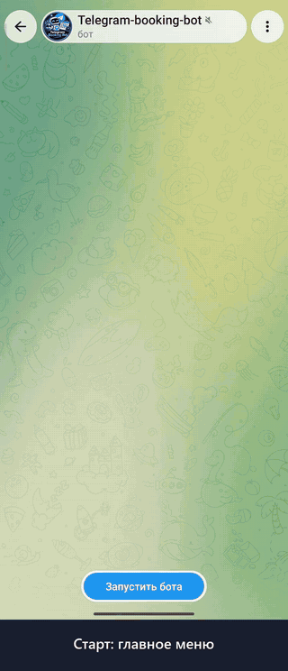

# Telegram-бот онлайн-записи

<p align="center"></p>

🇬🇧 [English version](README.en.md)

aiogram 3 · SQLite (aiosqlite) · Docker

## Возможности

**Клиент**
- Запись: услуга → мастер (если их несколько) → дата → свободное время → имя → телефон (кнопкой «поделиться контактом» или текстом) → подтверждение
- Свободные слоты считаются по рабочему времени, перерывам, длительности услуги и уже занятым записям — у каждого мастера свои
- «Мои записи»: просмотр и отмена
- Напоминание за N минут до визита
- Имя и телефон подставляются из прошлой записи

**Администратор**
- Уведомление о каждой новой записи и отмене, отмена записи в один клик (клиент получает уведомление)
- `/today`, `/tomorrow`, `/day 05.11` — расписание на день
- `/services`, `/addservice Название | минуты | цена`, `/delservice ID`
- `/masters`, `/addmaster`, `/delmaster ID`, `/onmaster ID` — мастера (см. ниже)

**Мастер**
- Уведомления о записях и отменах к нему (если указан его Telegram ID)
- `/schedule` — своё расписание на сегодня и завтра

**Надёжность**
- Двойное бронирование исключено: проверка пересечения и вставка выполняются в одной транзакции `BEGIN IMMEDIATE`
- Повторная проверка слота при подтверждении и защита от устаревших кнопок
- Лимит активных записей на клиента
- Нельзя отменить чужую запись через подменённые данные кнопки

## Несколько мастеров

Необязательно. Пока мастеров нет (или активен только один), бот работает как раньше: одно расписание, шаг выбора мастера не показывается. Когда активных мастеров два и больше, клиент выбирает мастера после услуги, и слоты считаются отдельно для каждого: к одному мастеру нельзя записаться дважды на одно время, к разным — можно.

```
/addmaster Арман | 123456789                                  — общий график из .env, уведомления в Telegram
/addmaster Данияр | - | 12:00-20:00 | 2,3,4,5,6 | 15:00-15:30  — свой график
/masters                                                      — список и ID
/delmaster 2                                                  — отключить (записи сохраняются)
/onmaster 2                                                   — включить снова
```

Поля после имени: Telegram ID мастера, часы, рабочие дни (1 = Пн), перерывы. Все необязательные: пусто или `-` — берётся общий график из `.env` (`WORK_START`, `WORK_END`, `WORK_DAYS`, `BREAKS`), перерывы `0` — без перерывов. Узнать Telegram ID мастер может у @userinfobot.

Мастер с Telegram ID получает уведомления о записях к нему и их отменах и командой `/schedule` смотрит своё расписание на сегодня и завтра. Админ в `/today`, `/tomorrow`, `/day` видит записи по мастерам. Имя мастера есть в карточке записи, в «Моих записях» и в напоминании.

Старые базы обновляются автоматически при запуске. Записи, сделанные до появления мастеров, ни к кому не привязаны и занимают это время у всех мастеров — так двойной записи точно не будет.

## Демо-режим

`DEMO_MODE=1` — для показа заказчикам. После записи клиент получает копию карточки, которую видит владелец, с рабочей кнопкой отмены — только для своей записи. Админ-команды и чужие записи остаются недоступны. Если мастеров ещё нет, создаются два демо-мастера (у второго свой график 12:00–20:00), чтобы показать выбор мастера.

## Язык интерфейса

`BOT_LANG=ru` (по умолчанию) или `BOT_LANG=en` — весь интерфейс бота на английском: кнопки, сообщения, даты, формат цен (`CURRENCY=$` → `$1,200`). Язык задаётся на весь экземпляр бота: для английской версии запускается отдельная копия со своим токеном. Тексты в коде пишутся по-русски и оборачиваются в `_()`, переводы лежат в `bot/locales/en.py`. Тест `tests/test_i18n.py` проверяет, что ни одна строка не забыта.

## Запуск

```bash
cp .env.example .env   # заполнить BOT_TOKEN и ADMIN_IDS
```

Docker:
```bash
docker compose up -d --build
```

Без Docker (Python 3.11+):
```bash
python -m venv .venv && . .venv/bin/activate
pip install -r requirements.txt
python -m bot
```

База создаётся в `data/bot.db` и при первом запуске заполняется тремя демо-услугами. Мастеров по умолчанию нет — добавьте их командой `/addmaster`, если нужно.

## Настройки (`.env`)

| Переменная | По умолчанию | Описание |
|---|---|---|
| `BOT_TOKEN` | — | Токен от @BotFather |
| `ADMIN_IDS` | — | ID администраторов через запятую |
| `TIMEZONE` | `Asia/Almaty` | Часовой пояс бизнеса |
| `CURRENCY` | `₸` | Валюта |
| `WORK_START` / `WORK_END` | `10:00` / `20:00` | Рабочее время |
| `BREAKS` | — | Перерывы: `13:00-14:00,17:00-17:15` |
| `WORK_DAYS` | `1,2,3,4,5,6` | Рабочие дни (1 = Пн) |
| `SLOT_STEP_MINUTES` | `30` | Шаг сетки |
| `DAYS_AHEAD` | `14` | На сколько дней вперёд открыта запись |
| `MIN_LEAD_MINUTES` | `60` | Минимум до начала записи |
| `REMIND_BEFORE_MINUTES` | `120` | Напоминание (0 — выключить) |
| `MAX_ACTIVE_PER_USER` | `3` | Лимит активных записей |
| `DEMO_MODE` | `0` | Демо-режим для показа заказчикам |
| `BOT_LANG` | `ru` | Язык интерфейса: `ru` или `en` |

## Структура

```
bot/
  __main__.py      точка входа, сборка Dispatcher
  config.py        настройки из .env
  db.py            SQLite: схема, миграция и запросы
  slots.py         расчёт свободных слотов, график мастера
  keyboards.py     клавиатуры и CallbackData
  states.py        FSM-состояния записи
  reminders.py     фоновая отправка напоминаний
  notify.py        отправка уведомлений
  utils.py         форматирование, телефон, время
  handlers/
    client.py      сценарий клиента
    admin.py       админ-команды
    master.py      команды мастера (/schedule)
tests/            сквозные тесты без Telegram
```

## Тест

```bash
python -m tests.test_flow   # сквозной сценарий (русский)
python -m tests.test_en     # английская версия: сценарий + нет кириллицы
python -m tests.test_i18n   # все строки обёрнуты и переведены
python -m tests.test_masters # мастера: миграция, слоты по мастеру, пропуск шага, уведомления
```
